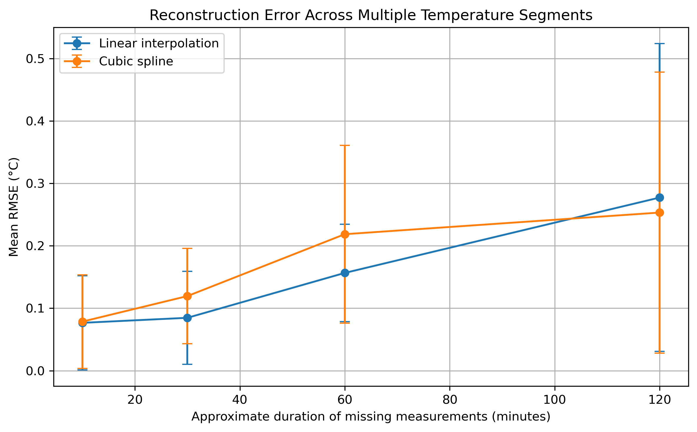
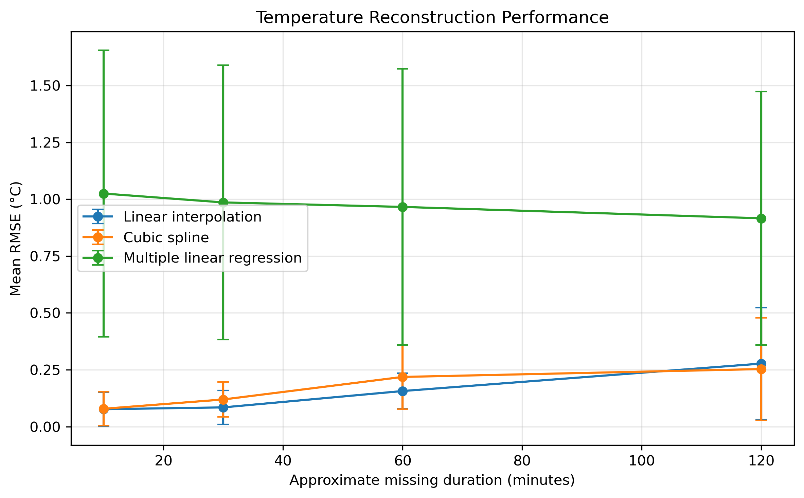

# MMA3001 Missing Indoor Temperature Sensor Reconstruction

## Project Overview

Indoor environmental monitoring systems rely on continuous sensor measurements to support building operation, environmental assessment, and data analysis. However, sensor measurements may be temporarily unavailable because of communication failures, sensor faults, or data transmission issues.

This project investigates how accurately missing indoor temperature measurements can be reconstructed using numerical interpolation and a simple machine learning approach.

The main research question is:

> **How accurately can different numerical and data-driven methods reconstruct missing indoor temperature sensor measurements for different missing-data durations?**

Three reconstruction methods are compared:

- Linear interpolation
- Cubic spline interpolation
- Multiple linear regression using humidity and pressure

---

## Dataset

The environmental sensor dataset contains measurements from multiple indoor sensors.

The analysis focuses on sensor:

`6012002000869`

The original temperature data contained approximately 29,341 records. After duplicate timestamps were checked and removed, 13,800 unique measurements remained.

The main sampling interval is approximately 10 minutes.

The dataset contains environmental variables including:

- Temperature
- Humidity
- Pressure
- Carbon dioxide
- Formaldehyde
- Volatile organic compounds
- Particulate matter

Temperature is used as the reconstruction target, while humidity and pressure are additionally investigated as predictor variables for the regression model.

The raw dataset is not included in the repository because of its file size.

---

## Data Processing

The main preprocessing steps are:

1. Extract environmental variables from the JSON sensor data.
2. Convert Unix timestamps to datetime values.
3. Convert environmental measurements to numeric values.
4. Check for missing values.
5. Check for conflicting duplicate timestamps.
6. Remove duplicate measurements.
7. Calculate time differences between consecutive measurements.
8. Identify continuous temperature measurement blocks.

A measurement interval is considered continuous when it is approximately 10 minutes, with a tolerance of ±5 seconds.

The three longest continuous blocks used for the final validation are:

| Block | Measurements | Duration |
|---|---:|---:|
| 157 | 66 | 10 h 50 min |
| 196 | 65 | 10 h 40 min |
| 193 | 55 | approximately 9 h |

---

## Reconstruction Methods

### Linear Interpolation

Linear interpolation reconstructs missing measurements using a straight line between the surrounding known measurements.

This method is simple, computationally inexpensive, and suitable when temperature varies gradually over a short period.

### Cubic Spline Interpolation

Cubic spline interpolation fits smooth cubic polynomial segments through the available measurements.

It provides smoother reconstruction than linear interpolation but is more computationally complex and may behave differently depending on the local shape of the temperature data.

### Multiple Linear Regression

Multiple linear regression was investigated as an additional data-driven reconstruction method.

Humidity and pressure were used as predictor variables:

\[
Temperature = \beta_0 + \beta_1 Humidity + \beta_2 Pressure
\]

The observed correlations with temperature were relatively weak:

- Temperature vs Humidity: approximately -0.123
- Temperature vs Pressure: approximately -0.104

This indicates that humidity and pressure alone contain limited information for predicting temperature in this dataset.

---

## Validation Method

Artificial missing-data gaps were created inside continuous temperature segments.

The original temperature values were retained as ground truth before the selected measurements were removed.

Four missing-data durations were investigated:

| Missing measurements | Approximate duration |
|---:|---:|
| 1 | 10 minutes |
| 3 | 30 minutes |
| 6 | 60 minutes |
| 12 | 120 minutes |

For each missing duration:

- 3 continuous temperature blocks were tested.
- 5 positions were tested within each block.
- This produced 15 tests per missing duration.
- A total of 60 reconstruction experiments were performed.

Reconstruction accuracy was evaluated using:

**Mean Absolute Error (MAE)**

\[
MAE = \frac{1}{n}\sum |y_i-\hat{y}_i|
\]

**Root Mean Square Error (RMSE)**

\[
RMSE = \sqrt{\frac{1}{n}\sum(y_i-\hat{y}_i)^2}
\]

---

## Results

The mean RMSE values across the three continuous temperature segments were:

| Approximate Missing Duration | Linear RMSE (°C) | Cubic Spline RMSE (°C) | Regression RMSE (°C) |
|---:|---:|---:|---:|
| 10 min | 0.0767 | 0.0786 | 1.0248 |
| 30 min | 0.0847 | 0.1195 | 0.9859 |
| 60 min | 0.1566 | 0.2186 | 0.9661 |
| 120 min | 0.2772 | 0.2532 | 0.9160 |

The results show that reconstruction error generally increases as the duration of the missing temperature measurements becomes longer.

Linear interpolation produced slightly lower mean RMSE for the 10, 30 and 60 minute gaps.

Cubic spline interpolation produced a slightly lower mean RMSE for the longest 120 minute gap.

The multiple linear regression model produced substantially larger reconstruction errors than both interpolation methods for all tested gap durations.

This is consistent with the weak relationships observed between temperature, humidity and pressure.

Therefore, time-based interpolation is more suitable for this dataset than the tested regression model.

For short and medium gaps, linear interpolation provides a particularly good balance between reconstruction accuracy, simplicity and computational cost.

---

## Main Result Figures

### Interpolation Performance



### Comparison of Three Reconstruction Methods



---

## Repository Structure

```text
MMA3001-Occupancy-Prediction/
│
├── Data/
│   ├── raw/
│   └── processed/
│
├── notebooks/
│   └── 01_data_exploration.ipynb
│
├── src/
│   ├── __init__.py
│   ├── data_processing.py
│   ├── interpolation.py
│   ├── evaluation.py
│   └── ml_model.py
│
├── tests/
│   ├── test_interpolation.py
│   └── test_evaluation.py
│
├── results/
│   ├── figures/
│   └── tables/
│
├── doc/
│   └── index.html
│
├── requirements.txt
├── .gitignore
├── LICENSE
└── README.md

Installation
Python 3.12 was used for the project.
Install the required Python packages with:
python -m pip install -r requirements.txt

Running the Analysis
Open the main Jupyter notebook:
jupyter notebook notebooks/01_data_exploration.ipynb

The notebook contains the complete data exploration, preprocessing, reconstruction experiments, validation, machine learning comparison, and result generation workflow.
Testing
Automated tests are included for the main interpolation and evaluation functions.
Run the tests from the project root directory using:
python -m pytest -v

The current test suite contains five tests covering:
- Artificial missing-gap creation
- Linear interpolation
- Cubic spline interpolation
- MAE calculation
- RMSE calculation
All five tests pass successfully.
API Documentation
HTML documentation for the Python source modules was generated using pdoc.
To regenerate the documentation:
python -m pdoc src -o doc

On macOS, the generated documentation can be opened with:
open doc/index.html

Limitations
The reconstruction results are based on one selected indoor sensor and a limited number of long continuous temperature segments.
The performance of the methods may differ for other sensors, buildings, seasons, environmental conditions, or longer periods of missing data.
The regression model only uses humidity and pressure as predictors. Other environmental variables or more advanced machine learning methods could potentially improve data-driven reconstruction.
The results therefore demonstrate performance for this dataset rather than a universal reconstruction accuracy for all indoor sensor systems.
Future Work
Future work could investigate additional sensors, more continuous measurement periods, additional environmental predictor variables, and more advanced machine learning models.
Machine learning approaches could also incorporate time-related features or neighbouring temperature measurements to determine whether they can improve reconstruction performance compared with numerical interpolation.
AI Use
AI tools were used during the project to support coding, debugging, documentation, and interpretation of computational results.
All code was executed and tested by the author. Generated suggestions were checked against the dataset, numerical results, automated tests, and project requirements before being included in the final workflow.
A more detailed discussion of AI use, verification, limitations, and learning outcomes is provided in the project documentation.


