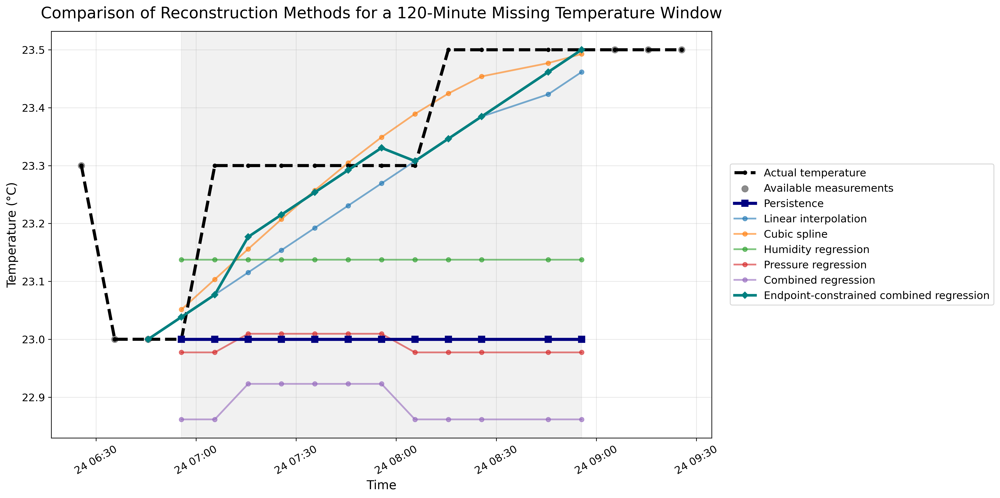

# MMA3001 — Reconstruction of Missing Indoor Temperature Sensor Measurements

**MMA3001: Numerical Methods and Machine Learning | Monash University**

## Project Overview

Indoor temperature measurements are used to assess building environmental conditions and support HVAC-related analysis. Sensor faults, communication interruptions, or missing transmissions can leave gaps in these measurements. This project investigates how accurately missing **historical** indoor temperatures can be reconstructed using numerical interpolation and regression-based methods.

## Final Report

[View the final project report](report/MMA3001_Final_Report.pdf)

**Research question:** *How accurately can different numerical and data-driven methods reconstruct missing indoor temperature measurements, and how does performance change with missing-data duration?*

The project follows three stages:

1. **Initial six-method comparison:** Evaluate persistence, linear interpolation, cubic spline interpolation, and three environmental regression models.
2. **Method improvement:** Investigate why the original combined regression performs poorly and introduce an **endpoint-constrained regression** correction.
3. **Final seven-method comparison:** Re-evaluate all methods on the same artificially missing temperature windows and examine the trade-off between accuracy and computational runtime.

The original six-method results are retained to document the development of the improved method.

## Dataset and Availability

The analysis uses the course-provided environmental sensor dataset:

`5EnvSensor_MayToDec2024_180kRows.csv`

- **Selected sensor ID:** `6012002000869`
- **Cleaned observations:** 13,800 unique timestamped records
- **Observed period for this sensor:** 29 February–13 June 2024
- **Reconstruction target:** temperature (°C)
- **Additional regression predictors:** relative humidity (%RH) and atmospheric pressure (mb)
- **Typical sampling interval:** approximately 10 minutes, with occasional irregular intervals

| Variable | Mean | Standard deviation | Observed range |
|---|---:|---:|---:|
| Temperature (°C) | 23.09 | 1.16 | 19.0–28.5 |
| Relative humidity (%RH) | 45.03 | 7.39 | 26–75 |
| Pressure (mb) | 1017.83 | 5.66 | 1002–1028 |

### Raw data access

**The original CSV is not included in the public GitHub repository.** It is excluded from version control using `.gitignore`. To reproduce the complete analysis, an authorised user must obtain the original course dataset and place it at:

`Data/raw/5EnvSensor_MayToDec2024_180kRows.csv`

For the MMA3001 assessment, the raw CSV should be supplied **separately through Moodle or via an accessible, appropriately permissioned external link**, as required by the project deliverables. The repository includes the derived figures, summary tables, code, and documentation but cannot regenerate results without access to the raw data.

## Data Preparation

The Python workflow:

1. Extracts timestamp, temperature, humidity, and pressure measurements from sensor JSON records.
2. Converts Unix timestamps to datetime values and measurements to numeric values.
3. Checks duplicate timestamps and excludes incomplete observations.
4. Retains one observation per timestamp and sorts the data chronologically.
5. Uses the first **80%** of observations (**11,040 records**) to train regression models and the later **20%** (**2,760 records**) for reconstruction evaluation.

The split is chronological rather than random to avoid training regression models on observations from the held-out test period. Interpolation and endpoint-constrained reconstruction can use **known temperatures after a gap**, because this study concerns retrospective reconstruction, not real-time forecasting.

## Reconstruction Methods

The initial comparison uses six methods:

| Method | Main idea | Required information |
|---|---|---|
| **Persistence** | Carry the last known temperature forward | Known temperature before the gap |
| **Linear interpolation** | Estimate temperatures on a straight line | Actual timestamps and temperatures at both endpoints |
| **Natural cubic spline** | Fit a smooth piecewise cubic curve | Four known temperature observations on each side of the gap |
| **Humidity regression** | Predict temperature from relative humidity | Humidity observations and a fitted model |
| **Pressure regression** | Predict temperature from atmospheric pressure | Pressure observations and a fitted model |
| **Combined regression** | Predict temperature from humidity and pressure | Both predictors and a fitted model |

The combined regression model is

$$
\hat{T}_{\mathrm{reg}}(t)=\beta_0+\beta_H H(t)+\beta_P P(t).
$$

The three regression models are fitted using `sklearn.linear_model.LinearRegression` on the chronological training subset. In contrast with interpolation, the original regression predictions are **not required to match the known temperatures bordering the missing interval**.

### Seventh method: endpoint-constrained combined regression

The original combined regression often produced a discontinuity between its predictions and the known temperature measurements on either side of the gap. The improved method corrects those predictions using the two observed boundary temperatures.

With known endpoints $(t_L,T_L)$ and $(t_R,T_R)$, define

$$
\alpha(t)=\frac{t-t_L}{t_R-t_L}.
$$

The corrected reconstruction is

$$
\hat{T}_{\mathrm{EC}}(t)=\hat{T}_{\mathrm{reg}}(t)
+(1-\alpha(t))\left[T_L-\hat{T}_{\mathrm{reg}}(t_L)\right]
+\alpha(t)\left[T_R-\hat{T}_{\mathrm{reg}}(t_R)\right].
$$

This is a **time-weighted boundary correction**. It leaves the original regression coefficients unchanged; it **does not reduce the regression model's degrees of freedom**. Its substantial improvement partly reflects the additional information provided by the observed temperature endpoints, rather than only improved use of humidity and pressure.

## Validation and Verification

Ground-truth temperature readings are artificially withheld from the held-out testing data. Each candidate missing window uses actual timestamps and requires four available observations before and four after the interval. The hidden temperature values are used **only for scoring**, not to construct the predictions.

| Nominal missing duration | Windows |
|---|---:|
| 10 minutes | 15 |
| 30 minutes | 15 |
| 60 minutes | 15 |
| 120 minutes | 15 |
| **Total** | **60** |

- **Initial comparison:** 60 windows × 6 methods = **360 method-window evaluations**.
- **Final comparison:** 60 windows × 7 methods = **420 method-window evaluations**.
- All methods use the **same missing windows**. The number of hidden readings can vary because the original sampling is not perfectly uniform.

### Evaluation metrics

Reconstruction accuracy is measured against the original withheld temperatures using **MAE** and **RMSE** (both in °C), and **NRMSE** (in %):

$$
\mathrm{MAE}=\frac{1}{n}\sum_{i=1}^{n}|T_i-\hat T_i|,
\qquad
\mathrm{RMSE}=\sqrt{\frac{1}{n}\sum_{i=1}^{n}(T_i-\hat T_i)^2}.
$$

$$
\mathrm{NRMSE}(\%)=\frac{\mathrm{RMSE}}{T_{\max,\mathrm{test}}-T_{\min,\mathrm{test}}}\times100.
$$

The held-out test set has a temperature range of **19.5–25.5°C**, so the NRMSE denominator is **6.0°C**. Results are reported as the **mean of the window-level errors** for each method and duration. Lower values are better. NRMSE is an error normalised by the test-set range; it is **not a universal accuracy score or correlation coefficient**.

Automated `pytest` tests check interpolation, error calculations, missing-window generation, reconstruction evaluation, and the endpoint-constraint property. The last verified suite contained **8 passing tests**. See [Testing](#testing-and-api-documentation) for the command to run them and save a test report.

## Results

### Mean NRMSE (%) across missing durations

| Method | 10 min | 30 min | 60 min | 120 min |
|---|---:|---:|---:|---:|
| Persistence | 1.2222 | 2.8907 | 5.7316 | 8.8016 |
| Linear interpolation | 1.2216 | **1.4075** | **1.8261** | 3.1792 |
| Cubic spline | 1.3119 | 1.5979 | 2.1272 | 3.6176 |
| Humidity regression | 11.7334 | 11.7125 | 11.3655 | 12.8124 |
| Pressure regression | 11.9157 | 12.4124 | 12.3442 | 13.9177 |
| Combined regression | 15.4526 | 15.6619 | 15.0829 | 15.8383 |
| **Endpoint-constrained regression** | **1.2039** | 1.4825 | 1.8920 | **3.1035** |

The initial six-method evaluation showed that the humidity- and pressure-based regressions generally produced much larger errors than time-based interpolation. Introducing endpoint constraints dramatically reduced the error of the combined regression. For **120-minute gaps**, mean NRMSE fell from **15.8383%** to **3.1035%** (approximately **80.4% relative reduction**).

However, **linear interpolation remained slightly better for 30- and 60-minute gaps**, and the differences between linear and endpoint-constrained methods were small. This suggests that surrounding known temperatures provided particularly valuable reconstruction information in this dataset. The results do not establish statistically significant superiority or performance on independent sensors.

### Figure 1 — Initial six-method comparison


### Figure 2 — Final seven-method comparison


### Figure 3 — Representative 120-minute reconstruction



Additional exploratory figures are available in `results/figures/`.

### Computational runtime

Four representative methods were benchmarked using the same **60 missing windows**. Each method was timed over **20 repeated runs**, and the **median elapsed time** was reported.

| Method | Median runtime for 60 windows (ms) | Approx. per window (ms) |
|---|---:|---:|
| **Linear interpolation** | **0.0659** | 0.0011 |
| Cubic spline | 5.2052 | 0.0868 |
| Combined regression | 18.7317 | 0.2984 |
| Endpoint-constrained regression | 63.7809 | 1.0630 |

These values measure **reconstruction computation only**, excluding raw data loading, preprocessing, model training, and plotting. They depend on hardware and the Python implementation. Although the constrained method achieved marginally lower errors at some durations, **linear interpolation offered a favourable accuracy–runtime trade-off** for this dataset.

Detailed results are available in `results/tables/runtime_comparison.csv`.

## Repository Structure

```text
MMA3001-Missing-Sensor-Reconstruction/
├── README.md
├── LICENSE
├── requirements.txt
├── .gitignore
├── notebooks/
│   └── 01_data_exploration.ipynb
├── src/
│   ├── __init__.py
│   ├── data_processing.py
│   ├── interpolation.py
│   ├── ml_model.py
│   ├── evaluation.py
│   └── validation.py
├── tests/
│   ├── test_evaluation.py
│   ├── test_interpolation.py
│   └── test_validation.py
├── results/
│   ├── figures/
│   │   ├── six_method_comparison.png
│   │   ├── seven_method_comparison.png
│   │   └── seven_method_reconstruction_120min.png
│   └── tables/
│       ├── missing_windows.csv
│       ├── six_method_validation_results.csv
│       ├── six_method_validation_summary.csv
│       ├── seven_method_validation_results.csv
│       ├── seven_method_validation_summary.csv
│       ├── regression_model_comparison.csv
│       └── runtime_comparison.csv
└── doc/
    ├── index.html
    ├── src.html
    └── src/                    # Generated pdoc HTML for the five modules
```

**Note:** `Data/raw/` must be created locally for the original CSV; it is intentionally not tracked in Git. The tree shows the main deliverables, not every exploratory output. A test report can be generated as `tests/test_report.txt` using the command below.

## Installation and Reproduction

### 1. Get the project

Clone the repository, then change into its root directory:

```bash
git clone https://github.com/ben12251230-afk/MMA3001-Missing-Sensor-Reconstruction.git
cd MMA3001-Missing-Sensor-Reconstruction
```

### 2. Install dependencies

Python **3.12** was used for development:

```bash
python -m pip install -r requirements.txt
```

The main libraries are `numpy`, `pandas`, `scipy`, `matplotlib`, `scikit-learn`, `pytest`, `pdoc`, and `jupyter`.

### 3. Supply the raw CSV

Place the separately provided original CSV at the expected path:

```bash
mkdir -p Data/raw
```

`Data/raw/5EnvSensor_MayToDec2024_180kRows.csv`

### 4. Run the Jupyter Notebook


### 4. Run the Jupyter Notebook

The notebook determines the project root automatically when launched from the repository root or the `notebooks/` directory. Place the raw CSV in `Data/raw/` before running the analysis.

Launch Jupyter Notebook from the repository root:

```bash
jupyter notebook notebooks/01_data_exploration.ipynb
```

Alternatively, run it from the `notebooks/` directory:

```bash
cd notebooks
jupyter notebook 01_data_exploration.ipynb
```

The notebook includes data exploration, preprocessing, interpolation, regression model fitting, six- and seven-method validation, figures, runtime benchmarking, and result exports.


### 5. Review generated results

- `results/tables/missing_windows.csv` — 60 artificial gaps.
- `results/tables/six_method_validation_results.csv` — 360 six-method window evaluations.
- `results/tables/six_method_validation_summary.csv` — 24 method–duration summaries.
- `results/tables/seven_method_validation_results.csv` — 420 seven-method window evaluations.
- `results/tables/seven_method_validation_summary.csv` — 28 method–duration summaries.
- `results/tables/regression_model_comparison.csv` — overall regression model comparison.
- `results/tables/runtime_comparison.csv` — measured runtimes for four representative methods.

**Note for notebook maintenance:** The final six-method export must exclude `Endpoint-constrained regression`. If rerunning an earlier experimental export cell overwrites the six-method CSV with seven-method results, rerun the final six-method filtering/export cell to restore **360 rows and six unique methods**.

## Testing and API Documentation

Run the automated tests from the **repository root**:

```bash
python -m pytest -v
```

To save an assessment-friendly text test report:

```bash
python -m pytest -v --no-header > tests/test_report.txt
```

Generate or refresh the pdoc HTML documentation after editing module docstrings:

```bash
python -m pdoc src -o doc
```

On macOS, open the documentation in a browser with:

```bash
open doc/index.html
```

The package includes documentation for `data_processing`, `interpolation`, `ml_model`, `evaluation`, and `validation`. The generated HTML files are also versioned under `doc/`.

## Limitations and Future Work

- **Single sensor:** Performance may change across buildings, sensors, seasons, and operating conditions.
- **Short gaps:** Only 10-, 30-, 60-, and 120-minute windows were studied; full-day outages were not validated.
- **Retrospective setting:** Interpolation and constrained regression require future-side boundary temperature measurements. These methods do not directly forecast an ongoing gap.
- **Partial predictor availability:** Humidity- and pressure-based regressions assume those variables remain available during the temperature gap. A complete sensor outage may invalidate this assumption.
- **Method selection:** The endpoint-constrained approach was developed after inspecting the initial results and evaluated on the same windows; additional independent periods and sensors are needed for stronger generalisation claims.
- **Numerical behaviour:** Cubic splines may overshoot, and none of these methods guarantees accurate reconstruction of abrupt temperature events between measurements.
- **Performance:** Runtime was benchmarked for four methods on one Python environment, not across other hardware or under memory constraints.

Future work could study longer interruptions, additional sensors, independent validation periods, uncertainty bounds, and other predictors or time-related features.

## AI Use and Critical Reflection

The research direction and engineering questions were chosen by the author. I selected missing indoor temperature reconstruction as the project topic and decided to investigate and compare numerical interpolation and regression methods. After defining the research goals, I asked ChatGPT to generate Python code to implement the planned workflow.

- Code generation and implementation: ChatGPT drafted code for data cleaning, interpolation, regression models, error metrics, and validation experiments based on my requests.
- Debugging and refinement: I used ChatGPT to identify errors, adjust code, improve the notebook structure, and prepare plots, tests, and documentation.
- Method development: After reviewing the initial six-method results, I investigated the poor regression performance and used ChatGPT to help implement and explain an endpoint-constrained correction for further comparison.
- Verification and responsibility: I ran the code, inspected results against the sensor data, compared reconstruction methods, and checked key calculations with automated tests. I also corrected misleading explanations, including the suggestion that endpoint constraints reduced the regression model’s degrees of freedom.

AI made implementation and technical learning more efficient, but the research direction, assessment of results, and final engineering judgments were my responsibility. AI-generated code and explanations were reviewed rather than treated as automatically correct.

## Reference Documentation

- [NumPy: `numpy.interp`](https://numpy.org/doc/stable/reference/generated/numpy.interp.html)
- [SciPy: `CubicSpline`](https://docs.scipy.org/doc/scipy/reference/generated/scipy.interpolate.CubicSpline.html)
- [scikit-learn: `LinearRegression`](https://scikit-learn.org/stable/modules/generated/sklearn.linear_model.LinearRegression.html)
