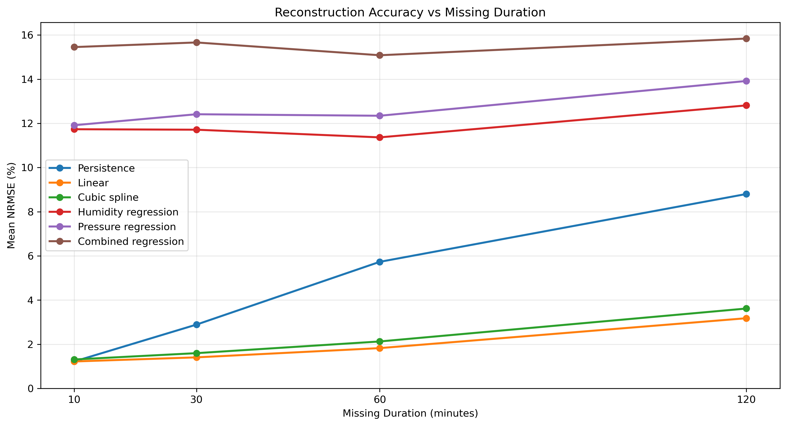
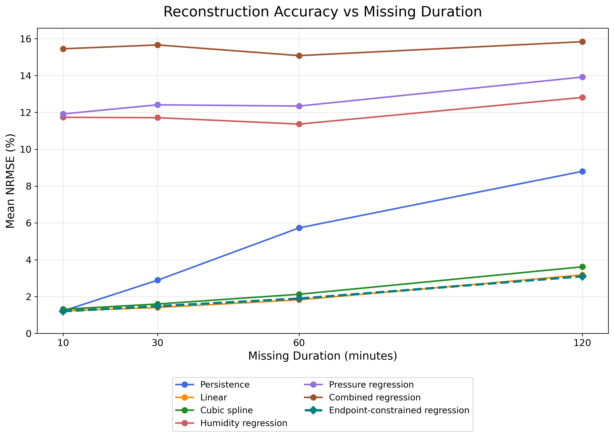

# MMA3001 — Reconstruction of Missing Indoor Temperature Sensor Measurements

## Project Overview

Indoor environmental monitoring systems depend on temperature measurements for building analysis and operational decisions. Missing measurements caused by sensor faults or transmission interruptions can reduce the usefulness of these records. This project investigates the reconstruction of artificially missing indoor temperature measurements using numerical interpolation and environmental regression models.

**Research question**

> How accurately can numerical and data-driven methods reconstruct missing indoor temperature sensor measurements, and how does reconstruction accuracy change with missing-data duration?

The study follows an iterative three-stage workflow:

1. **Initial six-method comparison:** evaluate six methods on 60 common windows (360 method-window evaluations) to establish the performance of interpolation and environmental regression against a simple persistence baseline.
2. **Method improvement:** address discontinuities in the combined regression estimates by imposing known temperature values at both ends of each missing window.
3. **Final seven-method validation:** evaluate the additional endpoint-constrained regression using the same missing windows and error metrics.

The original six-method results are retained to document the development and motivation of the improved method.

## Dataset

The supplied environmental sensor dataset contains observations from multiple indoor sensors. This project focuses on sensor **`6012002000869`** and uses temperature as the reconstruction target. Humidity and pressure are used as additional predictors for the regression models.

The selected source data contained approximately **29,341 records** before duplicate-timestamp processing. After cleaning and deduplication, **13,800 unique timestamped measurements** remained.

The nominal measurement interval is approximately **10 minutes**, although some intervals are around 20 minutes. The validation therefore uses actual timestamps rather than assuming that all samples are uniformly spaced.

Other environmental variables in the source dataset include carbon dioxide, formaldehyde, volatile organic compounds, and particulate matter; these are not used as regression features in the final comparison.

**Raw data availability:** The large raw sensor CSV is excluded from Git tracking. To reproduce the analysis, obtain the supplied dataset and place it at the raw-data path referenced in the notebook (under `Data/raw/`).

## Data Preparation and Experimental Design

The main preprocessing steps are:

1. Extract temperature, humidity, and pressure from the sensor records.
2. Convert Unix timestamps to datetimes and measurements to numeric values.
3. Check missing values and conflicting duplicate timestamps.
4. Retain one valid observation per timestamp and sort chronologically.
5. Inspect sampling intervals and identify the selected sensor's measurements.

For regression modelling, the cleaned dataset is split **chronologically** into 80% training data (**11,040 observations**) and 20% held-out test data (**2,760 observations**). Regression models are fitted on the training portion, while the reconstruction experiments use the test portion.

### Artificial missing-temperature windows

Observed temperatures are temporarily withheld so they can be used as **ground truth** when evaluating reconstruction accuracy. The missing interval is based on elapsed time, not a fixed number of rows.

| Nominal missing duration | Test windows |
|---|---:|
| 10 minutes | 15 |
| 30 minutes | 15 |
| 60 minutes | 15 |
| 120 minutes | 15 |
| **Total** | **60** |

Each experiment uses the same hidden positions across all compared methods. For interpolation, up to four known temperature observations immediately before and four immediately after the gap provide local support points. The actual number of withheld readings can differ between windows because the original measurement intervals are not perfectly regular.

The final comparison contains **60 windows × 7 methods = 420 method-window evaluations**. These are 420 evaluations, not 420 independent missing windows.

## Reconstruction Methods

### Stage 1 — Initial Six-Method Evaluation

1. **Persistence baseline:** Repeat the last known temperature before the missing interval. This provides a simple benchmark, not ground truth.
2. **Linear interpolation:** Reconstruct temperatures from known observations surrounding the gap using elapsed time.
3. **Cubic spline interpolation:** Fit a natural cubic spline using local temperature observations before and after the gap.
4. **Humidity regression:** Predict temperature from humidity alone.
5. **Pressure regression:** Predict temperature from pressure alone.
6. **Combined regression:** Predict temperature from humidity and pressure together.

The combined multiple linear regression model has the form

$$
\hat{T}_{\mathrm{reg}}(t)=\beta_0+\beta_1H(t)+\beta_2P(t).
$$

Unlike interpolation, the original regression predictions are not forced to meet the observed temperatures at the boundaries of the missing period. This can produce visible discontinuities.

### Stage 2 — Endpoint-Constrained Combined Regression

To address the discontinuities, the project introduces a **seventh method** that retains the fitted combined regression model but corrects its output to pass through the two known boundary temperatures.

Let \(t_0,t_1\) be the timestamps of the known observations immediately before and after the gap, with actual temperatures \(T_0,T_1\). Define

$$
\alpha(t)=\frac{t-t_0}{t_1-t_0}.
$$

The constrained reconstruction is

$$
\hat T_{\mathrm{constrained}}(t)=\hat T_{\mathrm{reg}}(t)
+(1-\alpha)(T_0-\hat T_{\mathrm{reg}}(t_0))
+\alpha(T_1-\hat T_{\mathrm{reg}}(t_1)).
$$

This correction enforces the **two endpoint values** while allowing the regression prediction to contribute variation within the gap. It **does not reduce the number of fitted regression coefficients**: it adds boundary constraints to the reconstruction. Neither endpoint is taken from the artificially withheld temperatures.

### Stage 3 — Final Seven-Method Evaluation

The endpoint-constrained approach is tested against all six original methods on **the same 60 missing windows**, allowing a consistent comparison before and after the modification.

## Evaluation Metrics

All methods are evaluated against the original, withheld sensor temperatures using:

- **Mean absolute error (MAE)**, in °C.
- **Root mean square error (RMSE)**, in °C.
- **Normalised RMSE (NRMSE)**, as a percentage of the held-out test temperature range.

$$
\mathrm{MAE}=\frac{1}{n}\sum_{i=1}^{n}|T_i-\hat T_i|,
\qquad
\mathrm{RMSE}=\sqrt{\frac{1}{n}\sum_{i=1}^{n}(T_i-\hat T_i)^2}.
$$

$$
\mathrm{NRMSE}(\%)=\frac{\mathrm{RMSE}}{T_{\max,\mathrm{test}}-T_{\min,\mathrm{test}}}\times 100.
$$

For this experiment, the held-out test temperatures range from **19.5°C to 25.5°C**; consequently, every method uses the same **6.0°C denominator**. A lower error is better. NRMSE should not be interpreted as a conventional prediction-accuracy percentage.

## Results

### Mean NRMSE by missing duration

The table reports the average *window-level NRMSE* for each method and duration, in percent.

| Method | 10 min | 30 min | 60 min | 120 min |
|---|---:|---:|---:|---:|
| Persistence | 1.2222 | 2.8907 | 5.7316 | 8.8016 |
| Linear interpolation | 1.2216 | **1.4075** | **1.8261** | 3.1792 |
| Cubic spline interpolation | 1.3119 | 1.5979 | 2.1272 | 3.6176 |
| Humidity regression | 11.7334 | 11.7125 | 11.3655 | 12.8124 |
| Pressure regression | 11.9157 | 12.4124 | 12.3442 | 13.9177 |
| Combined regression | 15.4526 | 15.6619 | 15.0829 | 15.8383 |
| **Endpoint-constrained regression** | **1.2039** | 1.4825 | 1.8920 | **3.1035** |

The six-method comparison showed that time-based interpolation substantially outperformed regression based only on humidity and pressure. Persistence also became less accurate as the missing duration increased, demonstrating the value of reconstructing a changing signal rather than simply carrying forward the last reading.

After endpoint correction, combined regression improved markedly. For **120-minute gaps**, mean NRMSE decreased from **15.8383%** (original combined regression) to **3.1035%** (endpoint-constrained regression). This was close to **3.1792%** for linear interpolation. Linear interpolation remained slightly better for the **30- and 60-minute** gaps, while the constrained approach was slightly better at **10 and 120 minutes** in this dataset.

**Interpretation:** The large improvement cannot be attributed solely to humidity and pressure because the constrained method additionally uses the known temperature values at both endpoints. The small differences between constrained regression and linear interpolation should not be overstated. Visual continuity at the endpoints also does not guarantee better predictions inside the gap; this is why all methods are evaluated against the hidden ground truth.

## Figures

### Initial six-method comparison



### Final seven-method comparison



Additional exploratory figures, including `reconstruction_example.png` and `rmse_vs_missing_duration.png`, are available in `results/figures/`.

## Reproducibility and Repository Structure

```text
MMA3001-Occupancy-Prediction/
├── Data/
│   ├── raw/                         # Raw dataset (excluded from Git)
│   └── processed/
├── notebooks/
│   └── 01_data_exploration.ipynb
├── src/
│   ├── __init__.py
│   ├── data_processing.py
│   ├── interpolation.py
│   ├── evaluation.py
│   ├── ml_model.py
│   └── validation.py
├── tests/
│   ├── test_interpolation.py
│   ├── test_evaluation.py
│   └── test_validation.py
├── results/
│   ├── figures/
│   │   ├── six_method_comparison.png
│   │   └── seven_method_comparison.png
│   └── tables/
│       ├── missing_windows.csv
│       ├── regression_model_comparison.csv
│       ├── six_method_validation_results.csv
│       ├── six_method_validation_summary.csv
│       ├── seven_method_validation_results.csv
│       └── seven_method_validation_summary.csv
├── doc/                              # Generated pdoc HTML documentation
├── requirements.txt
├── .gitignore
├── LICENSE
└── README.md
```

The tree lists the main project deliverables; additional exploratory plots and tables may also be present.

### Installation

Python **3.12** was used for development. From the repository root:

```bash
python -m pip install -r requirements.txt
```

### Running the analysis

Open and run the notebook from the project root:

```bash
jupyter notebook notebooks/01_data_exploration.ipynb
```

The notebook performs data exploration, preprocessing, regression training, construction of artificial missing windows, reconstruction, evaluation, visualisation, and result export. The supplied raw dataset must be available at the path expected by the notebook.

### Automated testing

```bash
python -m pytest -v
```

The current test suite contains **8 passing tests**, covering missing-gap generation, numerical interpolation, error calculations, the reconstruction validation workflow, and the endpoint constraint property.

### API documentation

Source-code documentation is generated with **pdoc**:

```bash
python -m pdoc src -o doc
```

On macOS, open the generated documentation with:

```bash
open doc/index.html
```

The `src.validation` module documents `create_missing_windows`, `endpoint_constrained_combined_regression`, and `validate_reconstruction`.

## Limitations and Future Work

- **Scope:** Results are based on one selected sensor and one held-out time period. Performance may differ across buildings, sensors, operating conditions, or seasons.
- **Gap length:** The study covers 10–120 minutes. These findings should not be extrapolated to a full-day outage without further validation.
- **Sampling:** Some original timestamps are approximately 20 minutes apart, so the number of hidden observations varies even when elapsed-time gap durations match.
- **Endpoint access:** Linear interpolation, cubic spline interpolation and endpoint-constrained regression require temperature measurements *after* the missing interval. They are therefore intended primarily for **retrospective data reconstruction**, not real-time prediction during an ongoing outage.
- **Predictors:** The regression models use only humidity and/or pressure. Other variables, lagged temperature data, time-of-day effects or richer models may provide additional information, but must be evaluated on held-out data.
- **Model comparison:** The relatively small differences between linear and endpoint-constrained methods warrant further evaluation using additional periods, sensors and temperature-change conditions before claiming one consistently outperforms the other.

Future work could investigate longer missing windows, abrupt environmental changes, daily-cycle-based reconstruction, uncertainty estimates, and validation across independent sensors.

## AI Use and Verification

AI tools, primarily ChatGPT, were used throughout this project to support programming, numerical analysis, debugging and documentation.

- **Data Processing:** AI assisted with cleaning sensor data, handling duplicate timestamps and identifying suitable measurements for analysis.
- **Method Implementation:** AI supported the implementation of interpolation methods, regression models and evaluation metrics (MAE, RMSE and NRMSE).
- **Method Improvement:** After identifying poor regression performance and discontinuities at missing-window boundaries, I used AI to help develop an endpoint-constrained regression method.
- **Validation and Testing:** AI assisted with comparing six initial methods, extending the evaluation to seven methods, debugging code and developing automated tests.
- **Critical Reflection:** I reviewed AI-generated suggestions, verified results against the dataset and made independent decisions about the project's direction and improvements.

Overall Reflection: AI was most useful for accelerating programming, exploring alternative methods and explaining numerical concepts. However, the most important improvements came from critically evaluating the results, identifying limitations and making informed engineering decisions. This project demonstrated that AI can support computational problem-solving, but its outputs must be independently verified rather than treated as automatically correct.
